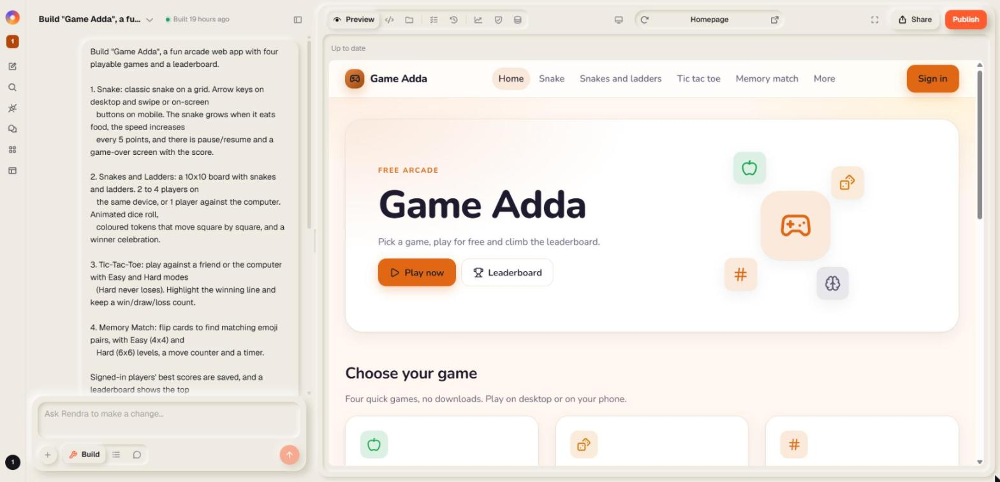
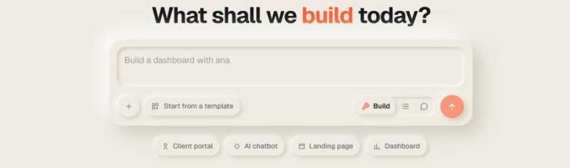
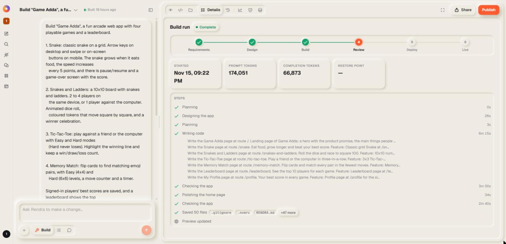
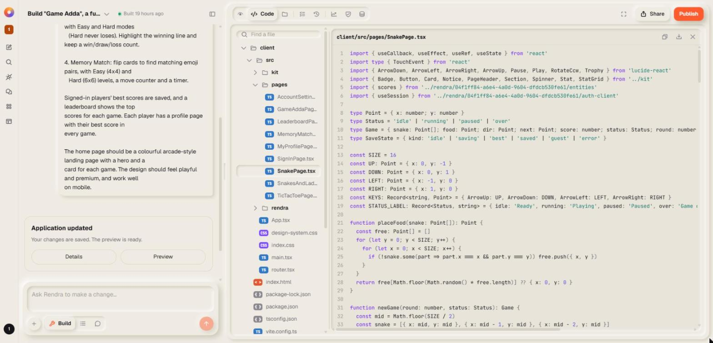
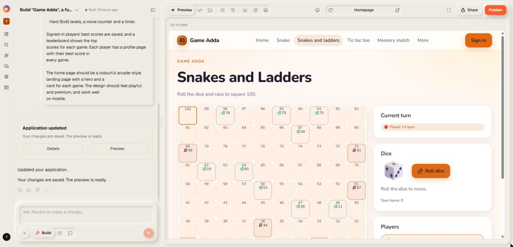
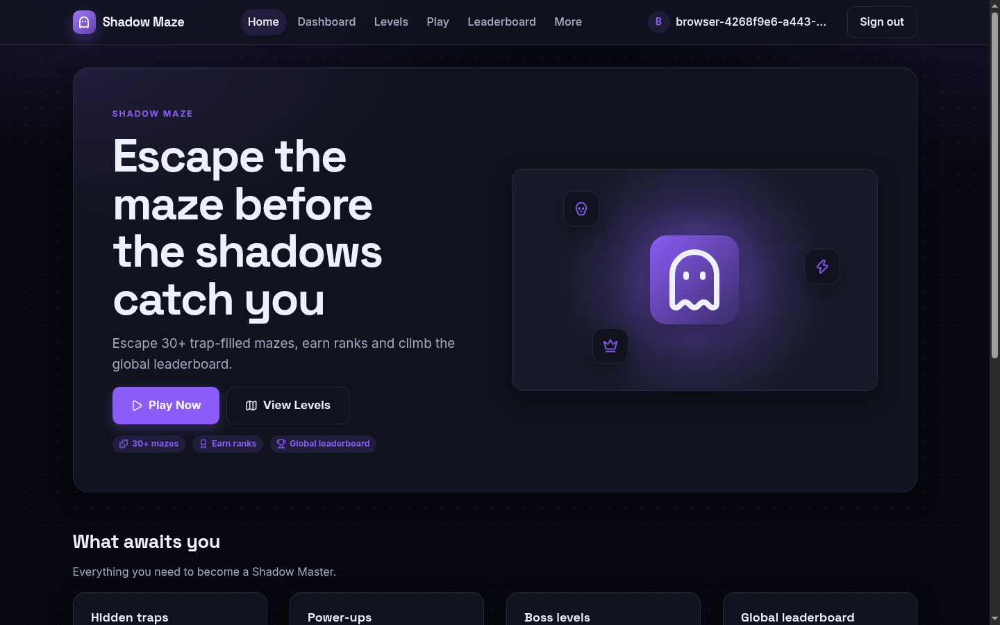
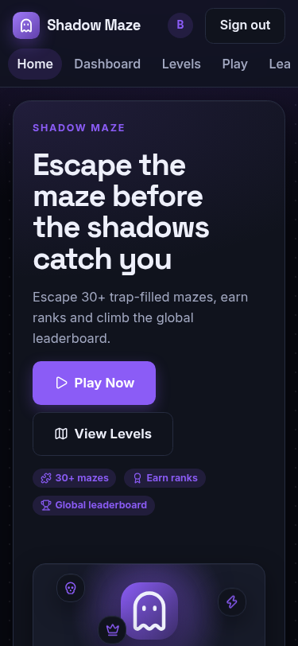
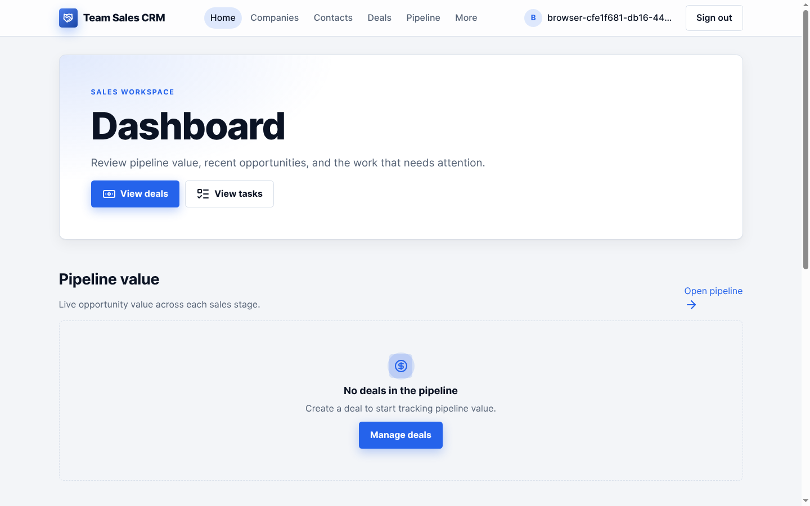
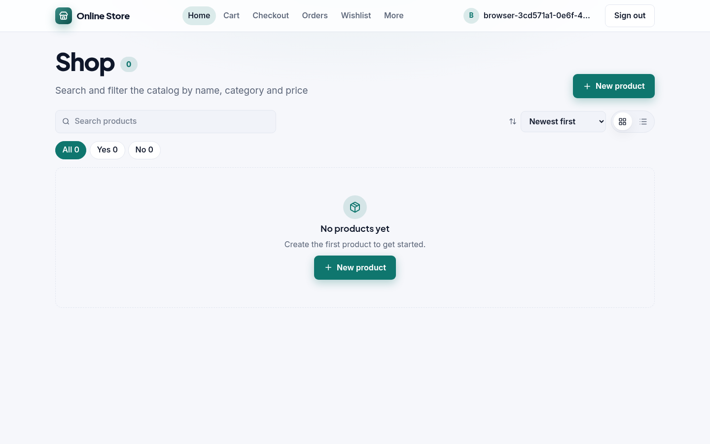
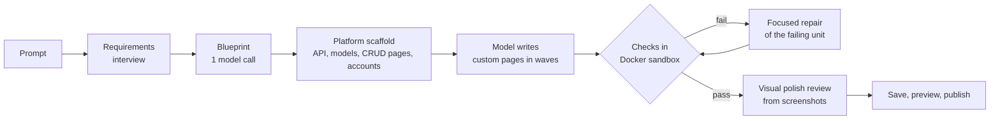

# Rendra

**Describe an app in plain words. Rendra plans it, builds a working full-stack app, checks it the way a QA engineer would, and hands you a live preview.**

Rendra is an AI application builder in the same space as Lovable, Bolt and v0, built from scratch as a Java 21 / Spring Boot platform with a React front end. It does not just send a prompt to a model and show whatever code comes back. Every build goes through a planned, checked and repaired pipeline, and is only saved once the app actually works.

> Status: active development, single-developer project. It runs end to end locally; it is not yet a hosted service. See the [roadmap](docs/ROADMAP.md).



*One prompt on the left. The finished, working app runs in a live preview on the right, in the same tab.*

## A quick tour

| Describe what you want | Follow every step of the build |
|---|---|
|  |  |

| Read the generated code | Use the generated app in the preview |
|---|---|
|  |  |

## Apps built by Rendra

Each of these was generated from a single short prompt, with no hand editing. Accounts, data storage, CRUD screens, search, filters and the mobile layout all came out of the pipeline. All the checks listed under "How a build works" passed before Rendra saved each app.

| A browser game ("Shadow Maze") | The same game on mobile |
|---|---|
|  |  |

| A team sales CRM | An online store |
|---|---|
|  |  |

## Why it is more than a prompt-to-code wrapper

Most AI builders ask a model for the whole app and hope it compiles. Rendra splits the work so that the model only writes what needs judgement, and the platform owns everything that must be correct:

- **Requirements first.** A short interview turns a vague idea into approved requirements, with recommended answers so the user is never blocked.
- **A blueprint, not a blob of code.** One model call produces a structured blueprint: entities, fields, access rules (owner, shared, admin), pages, icons and theme. The platform validates and normalises it before anything is written.
- **Zero-model-call scaffolding.** From the blueprint, the platform generates the REST API, database models, list, detail and form pages, sign-in, the account page and admin roles itself. These are deterministic, tested templates, so the plumbing never hallucinates.
- **The model writes only the creative parts.** Landing pages, dashboards and custom features are written by the model in parallel waves, against a premium UI kit it is told to use.
- **Real checks in a sandbox.** Every build runs in an isolated Docker sandbox with no network access. Dependencies are installed in a separate, short-lived container with install scripts disabled. Rendra checks the structure, type-checks and builds the app, then starts it. A headless browser loads it and clicks through it, and Rendra exercises each entity's API end to end: create, list, read, search, update, delete and persistence. Accounts are tested with the wrong password and with missing or invalid tokens.
- **Focused repair.** When a check fails, only the affected unit is regenerated, with the exact failure as feedback. Failures in platform-generated code stop the run immediately, instead of burning model calls on something a model cannot fix.
- **A visual review.** After everything passes, an image-capable model reviews desktop and mobile screenshots of the home page and suggests at most three concrete improvements. The page is regenerated once and re-checked; the polish is kept only if every check still passes.
- **Model-agnostic routing.** Each role (requirements, planning, code, repair, vision) has its own model and fallbacks. The same pipeline has passed its benchmarks on both Claude and GPT, and the router also supports open models through OpenAI-compatible providers.

## How a build works



Every run is a durable job: a Redis queue, a per-project lease with heartbeats, staged changes that only reach the live workspace after validation, and a recovery sweep that requeues or cleanly fails work abandoned by a crashed worker. More detail is in [docs/ARCHITECTURE.md](docs/ARCHITECTURE.md).

## Benchmarks

These are the platform's own end-to-end benchmark prompts, run on the current engine against a fresh database and sandbox. Each figure covers the whole build: requirements, blueprint, page generation, repairs, checks and polish.

| Prompt | Model route | Result | Time | Model calls |
|---|---|---|---|---|
| Todo app with accounts | Claude Code, Sonnet | Pass | 282 s | 7 |
| Online store (catalogue, cart, orders, admin) | Claude Code, Sonnet | Pass | 434 s | 11 |
| Team sales CRM (companies, contacts, deals, pipeline) | Codex CLI, GPT-5.6 | Pass | 776 s | 13 |
| Browser game with levels and leaderboard | Claude Code, Sonnet 5.5, medium effort | Pass, 40/40 checks, polish kept | 762 s | 13 |
| Same game | Claude Code, Sonnet 5.5, high effort | Pass, 53/53 checks, polish kept | 1340 s | 14 |

The backend has 1,638 automated tests, with 0 failures and 2 skipped.

## What works today

- Email and password sign-in, plus Google sign-in. Workspaces, roles and invite links.
- Build, chat and plan modes, with streaming agent replies over WebSocket.
- Requirements interview with approval, and image attachments with vision understanding.
- Generated full-stack apps: React and Vite clients, and Node and Express servers on a per-project MongoDB database.
- Staged edits, validation, bounded repair, build history, and rollback of the latest build.
- Live and draft previews on a separate origin, and static publishing.
- Optional Supabase connection with reviewed migrations.
- Light, dark and system themes across the Rendra interface.

## Tech stack

| Layer | Technology |
|---|---|
| Platform API | Java 21, Spring Boot 4.1, Spring Security (RS256 JWT cookies), Flyway |
| Data | PostgreSQL (platform), Redis (job queue, locks, realtime fan-out), MongoDB (generated apps) |
| Execution | Docker sandboxes (no network, resource limits), headless Chromium for runtime checks, a Node relay for generated servers |
| Front end | React 19, TypeScript, Vite, Tailwind CSS 4, TanStack Query |
| Models | OpenAI-compatible providers (Mistral, NVIDIA, Groq, OpenRouter), plus Claude Code and Codex CLI routes for local development |

The backend is a modular monolith: `identity`, `workspace`, `project`, `message`, `agent`, `realtime` and `notification` modules, with shared infrastructure.

## Running it locally

Rendra needs more moving parts than a typical web app, because it builds and runs other apps.

**Prerequisites**
- Java 21 and Node.js 22.
- PostgreSQL, Redis and MongoDB.
- Docker. On Windows, Docker inside WSL 2 is the tested setup.
- At least one model provider key, or a logged-in Claude Code or Codex CLI for local development.

**Steps**
1. Copy `.env.example` and fill in the values. Spring also imports `.secrets/secrets.properties`, which git ignores. Generate your own RS256 key pair for `JWT_PRIVATE_KEY` and `JWT_PUBLIC_KEY`.
2. Build the sandbox images from `src/main/resources/sandbox/browser` and `src/main/resources/sandbox/gateway`.
3. Start the backend:
   ```bash
   ./mvnw spring-boot:run        # API on http://localhost:8080
   ```
4. Start the front end:
   ```bash
   cd frontend
   npm ci
   npm run dev                   # UI on http://localhost:5173
   ```
5. Run the tests:
   ```bash
   ./mvnw "-Dtest=*Test" test
   ```

Set `AGENT_ENGINE=smart` to use the blueprint engine described above.

## Roadmap

The next steps are covered in [docs/ROADMAP.md](docs/ROADMAP.md):
- making the blueprint engine the default;
- API-key and bring-your-own-key model access;
- one-click publishing with custom domains;
- stronger per-project network isolation;
- more stacks;
- GitHub export.

## Security

Generated code is treated as untrusted. It runs only inside sandboxes, and previews are served from a separate origin. Please report vulnerabilities privately, as described in [SECURITY.md](SECURITY.md).

## License

[GNU AGPL-3.0](LICENSE). You may use, study and modify Rendra. If you run a modified version as a network service, you must publish your source under the same license.
