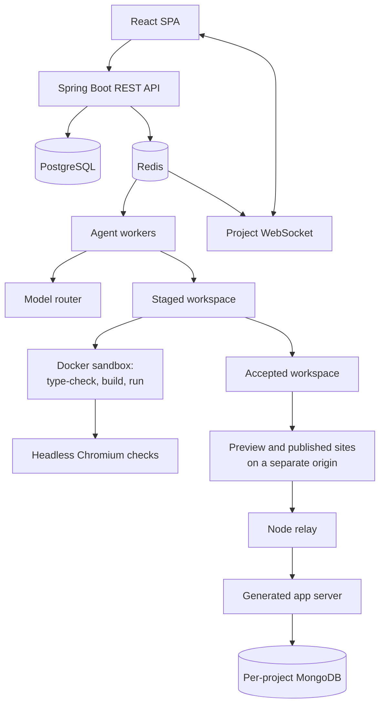

# Rendra architecture

This page explains how Rendra is put together and why. The [README](../README.md) gives the short version.

## System overview

The backend is a **modular monolith**. Each package owns its domain and talks to the others through services, not shared tables:

| Module | Responsibility |
|---|---|
| `identity` | Accounts, BCrypt passwords, Google OAuth, RS256 JWT access and refresh cookies |
| `workspace` | Workspaces, members, roles, invite links |
| `project` | Projects, requirements, build variables, per-project database, optional Supabase |
| `message` | Conversation history and accepted build requests |
| `agent` | Run queue, workers, model routing, generation engines, validation, previews |
| `realtime` | WebSocket delivery, fanned out across instances through Redis |
| `notification` | Persisted notification feed |

## The build engine

The current engine is the blueprint engine (`AGENT_ENGINE=smart`). It replaces an earlier pipeline in which the model planned and wrote everything.

### 1. Requirements

A short interview produces approved requirements. Every question has a recommended answer, so a user who only wants to describe the app once is never blocked.

### 2. Blueprint

One model call returns a JSON blueprint:
- the app's name, icon, design preset and accent colour;
- up to six **entities**, each with typed fields (text, number, boolean, date, enum with tones, image), a layout (grid or table), and display, search and filter fields;
- an **access rule** per entity: `OWNER` (private per user), `SHARED` (everyone reads, owners write) or `ADMIN`;
- up to eight **written pages** (landing, dashboard, custom features), with any approved paths kept first.

`BlueprintCompiler` validates and normalises the blueprint, for example by mapping icons to an allowlist, fixing detail paths and reserving `/account`. If the blueprint is invalid, one correction call states the exact problem.

### 3. Platform scaffold, with zero model calls

`CrudScaffold` turns the entities into tested code:
- a REST API with five endpoints per entity, with ownership enforced on the server;
- database models;
- list pages with search, sort, filter chips, card and table views, and empty and loading states;
- detail pages with edit and delete;
- forms;
- sign-in, an account page with password change, and admin roles. The first account becomes the admin.

All of this comes from versioned templates on a shared UI kit.

### 4. Model-written pages

Only the pages that need judgement go to the model, in parallel waves. Each unit sees the contract, the approved requirements, the UI kit's catalogue and the files it may change. Stable content comes first in each prompt, so that providers can cache it.

### 5. Checks

Every candidate build runs in a Docker sandbox with no network access:
- **Structure, type-check and build** of the generated client and server.
- **Runtime:** the app is started, and headless Chromium loads it and performs scripted interactions.
- **API chains for every entity:** create, list, read, search, update, persistence after restart, delete, and missing-record handling.
- **Account checks:** sign-up, login, wrong password, and missing or invalid tokens.
- **Browser flows:** the home page renders, each list opens, the create flow on the first list works, and every written page renders.

### 6. Repair

When a check fails, it is diagnosed back to the unit that caused it, and only that unit is regenerated, with the failure as feedback. A no-progress guard stops a model that keeps returning the same answer. If the failing unit was generated by the platform, the run stops immediately: retrying a model cannot fix platform code.

### 7. Visual polish

When every check passes and the home page was model-written, an image-capable model reviews desktop and mobile screenshots against the app standard. It returns at most three concrete, page-only changes. The home page is regenerated once and all checks run again. The polished page is kept only if they pass; otherwise the previous version is restored.

## Durable runs

A build can take many minutes, so runs are designed to survive restarts and crashes:
- **Queue:** runs go onto a Redis queue, and a fixed pool of worker threads caps concurrency.
- **Project lock:** each project has a lease-based lock, renewed by a heartbeat. A second request for the same project waits instead of racing.
- **Staged changes:** changes are written to a staged copy and only promoted to the live workspace after validation, under the lease.
- **Recovery sweep:** a scheduled sweep requeues deliveries lost from Redis, and fails or rolls back runs whose worker stopped heartbeating.
- **Run accounting:** model calls, tokens and time are recorded per run, and daily quotas are enforced.

## Model routing

Every model call has a purpose: requirements, planner, unit, repair, vision or chat. Each purpose has an ordered list of routes with fallbacks, and the routes are plain configuration:
- OpenAI-compatible providers such as Mistral, NVIDIA, Groq and OpenRouter;
- for local development only, the developer's own Claude Code or Codex CLI login.

A hosted deployment would use API keys only.

## Isolation and security

- Generated code is untrusted. It is built and run only inside resource-limited containers. Dependency installs run in a separate, short-lived container with lifecycle scripts disabled.
- Previews and published sites are served from a different origin from the API, with a restrictive Content-Security-Policy.
- Each generated app gets its own MongoDB database and user. It reaches the database only through a trusted relay.
- Secrets live in environment variables or an ignored properties file, never in the repository. Stored third-party tokens are encrypted with `APP_DATA_KEY`.

Known gaps, such as network isolation between different generated apps, are listed in the [roadmap](ROADMAP.md).
